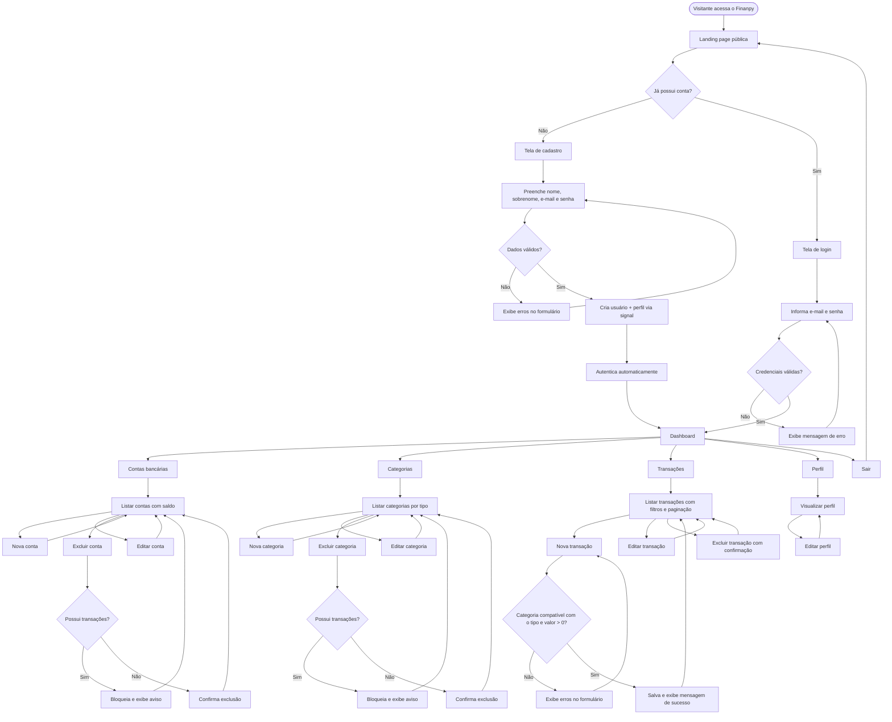
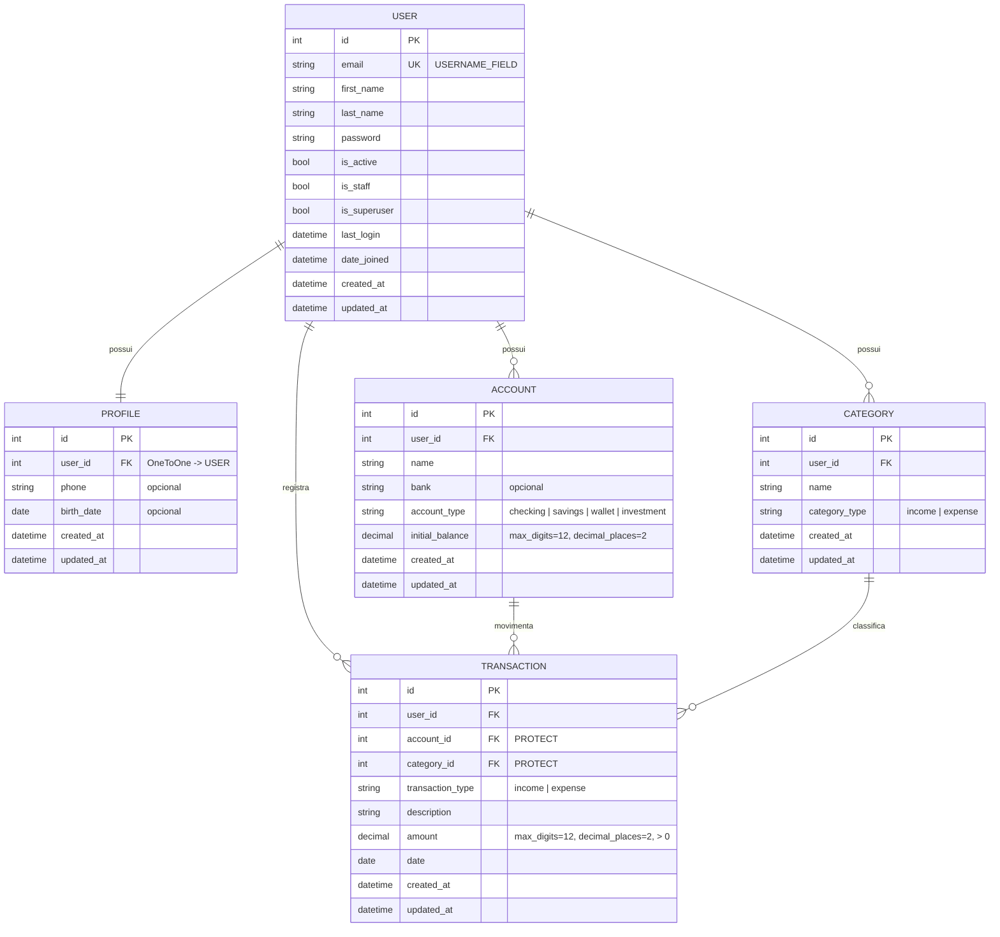

# PRD — Finanpy

> Product Requirement Document do **Finanpy**, sistema de gestão de finanças pessoais construído com Python e Django (full stack).

| Item | Valor |
|---|---|
| Produto | Finanpy |
| Versão do documento | 1.0 |
| Data | 28/10/2026 |
| Status | Rascunho para aprovação |

---

## 1. Visão geral

O **Finanpy** é uma aplicação web de gestão de finanças pessoais, simples e enxuta, que permite ao usuário cadastrar suas contas bancárias, organizar categorias de lançamentos e registrar transações de entrada e saída, acompanhando tudo em um dashboard central.

O sistema é construído com **Django full stack**: backend, autenticação, regras de negócio e frontend renderizado no servidor com **Django Template Language (DTL)** e estilizado com **TailwindCSS**, em uma interface moderna, responsiva, com fundo escuro e gradientes de cores harmônicas.

O projeto prioriza simplicidade: sem over engineering, usando ao máximo os recursos nativos do Django (Class Based Views, sistema de autenticação, ORM, forms, messages framework e admin).

---

## 2. Sobre o produto

O Finanpy é composto por duas grandes áreas:

1. **Site público de apresentação (landing page)**: apresenta o produto e oferece as opções **Cadastre-se** e **Login**.
2. **Área autenticada (sistema)**: acessível somente após login, com:
   - **Dashboard** com resumo financeiro (saldo total, entradas e saídas do mês, saldo por conta e últimas transações);
   - **Contas bancárias** (CRUD);
   - **Categorias** de entradas e saídas (CRUD);
   - **Transações** de entrada e saída (CRUD com filtros simples);
   - **Perfil** do usuário (visualização e edição).

O login é realizado com **e-mail e senha** (e não com username), utilizando o sistema nativo de autenticação do Django com um model de usuário customizado.

Toda a interface é exibida em **português brasileiro**; todo o código é escrito em **inglês**.

---

## 3. Propósito

Oferecer uma ferramenta direta e agradável para que pessoas físicas consigam:

- Saber **quanto dinheiro têm**, somando todas as suas contas;
- Entender **de onde vem e para onde vai** o dinheiro, por meio de categorias;
- Registrar o dia a dia financeiro com **poucos cliques**;
- Ter uma visão consolidada do **mês corrente** logo após o login.

Do ponto de vista técnico, o propósito é ter uma base de código **simples, legível e de fácil manutenção**, seguindo PEP 8, com responsabilidades isoladas em apps Django.

---

## 4. Público alvo

- **Pessoas físicas** que desejam organizar suas finanças pessoais sem a complexidade de planilhas ou de aplicativos com excesso de funcionalidades;
- Usuários com **múltiplas contas** (conta corrente, poupança, carteira) que querem uma visão unificada do saldo;
- Usuários de **desktop e mobile**, que acessam pelo navegador;
- Perfil de letramento digital básico a intermediário: a interface deve ser autoexplicativa.

---

## 5. Objetivos

### 5.1 Objetivos de produto

1. Permitir o cadastro e login de usuários por **e-mail**.
2. Permitir o gerenciamento completo (criar, listar, editar, excluir) de **contas bancárias**, **categorias** e **transações**.
3. Exibir um **dashboard** com o resumo financeiro do usuário logado.
4. Garantir que cada usuário veja e manipule **somente seus próprios dados**.
5. Entregar uma interface **moderna, responsiva e consistente** em todas as telas, guiada por um design system único.

### 5.2 Objetivos técnicos

1. Usar **somente recursos nativos do Django** sempre que possível (CBVs, auth, forms, messages, admin).
2. Isolar domínios em **apps Django** (`users`, `profiles`, `accounts`, `categories`, `transactions`).
3. Usar **SQLite** padrão do Django.
4. Código em inglês, **aspas simples**, aderente à **PEP 8**.
5. Todos os models com os campos **`created_at`** e **`updated_at`**.
6. Signals, quando usados, ficam em **`signals.py`** dentro da app correspondente.
7. Testes automatizados e Docker ficam para as **sprints finais**.

---

## 6. Requisitos funcionais

### 6.1 Site público

| ID | Requisito |
|---|---|
| RF-01 | O sistema deve ter uma página inicial pública (landing page) de apresentação do Finanpy. |
| RF-02 | A landing page deve exibir os botões **Cadastre-se** e **Entrar**. |
| RF-03 | Usuário já autenticado que acessar a landing page deve ver o botão **Ir para o dashboard** no lugar de Cadastre-se/Entrar. |

### 6.2 Usuários e autenticação

| ID | Requisito |
|---|---|
| RF-04 | O usuário deve poder se cadastrar informando nome, sobrenome, e-mail e senha (com confirmação). |
| RF-05 | O e-mail deve ser único no sistema. |
| RF-06 | Após o cadastro, o usuário deve ser autenticado automaticamente e redirecionado ao dashboard. |
| RF-07 | O login deve ser feito com **e-mail e senha**. |
| RF-08 | Após o login, o usuário deve ser redirecionado ao **dashboard**. |
| RF-09 | O usuário deve poder sair do sistema (logout), sendo redirecionado à landing page. |
| RF-10 | Páginas da área autenticada devem redirecionar usuários não logados para a tela de login. |
| RF-11 | Usuário autenticado que acessar login ou cadastro deve ser redirecionado ao dashboard. |

### 6.3 Perfil

| ID | Requisito |
|---|---|
| RF-12 | Todo usuário deve possuir um perfil criado automaticamente no momento do cadastro (via signal). |
| RF-13 | O usuário deve poder visualizar seu perfil (nome, e-mail, telefone, data de nascimento). |
| RF-14 | O usuário deve poder editar nome, sobrenome, telefone e data de nascimento. |

### 6.4 Contas bancárias

| ID | Requisito |
|---|---|
| RF-15 | O usuário deve poder cadastrar contas com: nome, banco, tipo (conta corrente, poupança, carteira, investimento) e saldo inicial. |
| RF-16 | O usuário deve poder listar suas contas, visualizando o saldo atual de cada uma. |
| RF-17 | O saldo atual da conta é calculado como: `saldo inicial + entradas − saídas`. |
| RF-18 | O usuário deve poder editar e excluir suas contas (com tela de confirmação de exclusão). |
| RF-19 | Não deve ser possível excluir uma conta que possua transações vinculadas; o sistema deve exibir mensagem explicativa. |

### 6.5 Categorias

| ID | Requisito |
|---|---|
| RF-20 | O usuário deve poder cadastrar categorias com nome e tipo (**Entrada** ou **Saída**). |
| RF-21 | O usuário deve poder listar, editar e excluir suas categorias. |
| RF-22 | O nome da categoria deve ser único por usuário e por tipo. |
| RF-23 | Não deve ser possível excluir uma categoria com transações vinculadas; o sistema deve exibir mensagem explicativa. |

### 6.6 Transações

| ID | Requisito |
|---|---|
| RF-24 | O usuário deve poder registrar transações com: tipo (Entrada/Saída), descrição, valor, data, conta e categoria. |
| RF-25 | Somente contas e categorias do próprio usuário devem ser listadas nos formulários. |
| RF-26 | A categoria escolhida deve ser do mesmo tipo da transação (entrada com categoria de entrada, saída com categoria de saída). |
| RF-27 | O valor da transação deve ser maior que zero. |
| RF-28 | O usuário deve poder listar suas transações ordenadas da mais recente para a mais antiga, com paginação. |
| RF-29 | A listagem deve permitir filtrar por tipo, conta, categoria e período (data inicial e final). |
| RF-30 | O usuário deve poder editar e excluir transações (com confirmação de exclusão). |

### 6.7 Dashboard

| ID | Requisito |
|---|---|
| RF-31 | O dashboard deve exibir o **saldo total** (soma dos saldos atuais de todas as contas). |
| RF-32 | O dashboard deve exibir o **total de entradas** e o **total de saídas** do mês corrente. |
| RF-33 | O dashboard deve exibir o **resultado do mês** (entradas − saídas). |
| RF-34 | O dashboard deve exibir a lista de **contas com seus saldos atuais**. |
| RF-35 | O dashboard deve exibir as **últimas 5 transações**. |
| RF-36 | O dashboard deve oferecer atalhos para **Nova transação**, **Nova conta** e **Nova categoria**. |

### 6.8 Feedback e mensagens

| ID | Requisito |
|---|---|
| RF-37 | Toda ação de criação, edição e exclusão deve exibir uma mensagem de feedback (Django messages framework) em português. |
| RF-38 | Listas vazias devem exibir um estado vazio (empty state) com chamada para a ação de cadastro. |

### 6.9 Flowchart dos fluxos de UX



---

## 7. Requisitos não-funcionais

| ID | Requisito |
|---|---|
| RNF-01 | **Simplicidade**: sem over engineering; nada além do especificado neste documento. |
| RNF-02 | **Stack nativa**: usar Class Based Views, forms, auth, messages e admin nativos do Django sempre que possível. |
| RNF-03 | **Idiomas**: código em inglês; toda informação na interface em português brasileiro (`LANGUAGE_CODE = 'pt-br'`). |
| RNF-04 | **Fuso horário**: `TIME_ZONE = 'America/Sao_Paulo'` com `USE_TZ = True`. |
| RNF-05 | **Padrão de código**: PEP 8 e aspas simples sempre que possível. |
| RNF-06 | **Banco de dados**: somente SQLite padrão do Django. |
| RNF-07 | **Auditoria mínima**: todo model possui `created_at` (`auto_now_add=True`) e `updated_at` (`auto_now=True`). |
| RNF-08 | **Isolamento de dados**: todas as queries da área autenticada filtradas pelo usuário logado; acesso a objeto de outro usuário retorna 404. |
| RNF-09 | **Segurança**: proteção CSRF nativa, senhas com hashers e validadores nativos do Django, `LoginRequiredMixin` em todas as views privadas. |
| RNF-10 | **Responsividade**: layout funcional a partir de 360px de largura (mobile first com Tailwind). |
| RNF-11 | **Consistência visual**: todas as telas seguem o design system definido na seção 9. |
| RNF-12 | **Desempenho**: páginas da área autenticada devem carregar em menos de 1s em ambiente local; uso de `select_related` em listagens com relacionamentos. |
| RNF-13 | **Valores monetários**: `DecimalField` (nunca `float`), exibidos no formato brasileiro (`R$ 1.234,56`). |
| RNF-14 | **Signals**: sempre em `signals.py` da app correspondente e registrados no `ready()` do `AppConfig`. |
| RNF-15 | **Testes e Docker**: implementados somente nas sprints finais. |

---

## 8. Arquitetura técnica

### 8.1 Stack

| Camada | Tecnologia |
|---|---|
| Linguagem | Python 3.13+ |
| Framework | Django 5.1+ (a tag `` da paginação exige 5.1) |
| Frontend | Django Template Language (DTL) |
| Estilização | TailwindCSS (v3 via CDN oficial, com `tailwind.config` e componentes `@apply` definidos no `base.html`) |
| Fonte | Inter (Google Fonts) |
| Banco de dados | SQLite (`db.sqlite`) |
| Autenticação | `django.contrib.auth` com model `User` customizado (login por e-mail) |
| Feedback | `django.contrib.messages` |
| Administração | `django.contrib.admin` |
| Testes (sprint final) | `django.test` (TestCase nativo) |
| Containerização (sprint final) | Docker + docker-compose |

### 8.2 Arquitetura de diretórios

Estrutura base solicitada, acrescida apenas dos arquivos necessários para o funcionamento (`urls.py`, `forms.py`, `signals.py`, `templates/`):

```
finanpy
├── accounts            # contas bancárias
│   ├── migrations/
│   ├── __init__.py
│   ├── admin.py
│   ├── apps.py
│   ├── forms.py
│   ├── models.py
│   ├── tests.py
│   ├── urls.py
│   └── views.py
├── categories          # categorias de lançamentos/transações
│   ├── ...             # mesma estrutura de accounts
├── core                # configurações globais do projeto
│   ├── __init__.py
│   ├── asgi.py
│   ├── settings.py
│   ├── urls.py
│   ├── views.py        # landing page e dashboard
│   └── wsgi.py
├── profiles            # perfis de usuários
│   ├── ...             # mesma estrutura + signals.py
├── transactions        # transações - entradas e saídas
│   ├── ...             # mesma estrutura de accounts
├── users               # usuários - herdando de User padrão do Django
│   ├── ...             # mesma estrutura + managers.py
├── templates
│   ├── base.html               # layout raiz + design system (Tailwind config + @apply)
│   ├── base_public.html        # layout do site público
│   ├── base_app.html           # layout da área autenticada (sidebar + topbar)
│   ├── components/             # partials reutilizáveis
│   │   ├── _messages.html
│   │   ├── _form_field.html
│   │   ├── _form.html
│   │   ├── _page_header.html
│   │   ├── _stat_card.html
│   │   ├── _empty_state.html
│   │   ├── _pagination.html
│   │   ├── _sidebar.html
│   │   ├── _topbar.html
│   │   └── _confirm_delete.html
│   ├── core/                   # landing.html, dashboard.html
│   ├── users/                  # login.html, signup.html
│   ├── profiles/
│   ├── accounts/
│   ├── categories/
│   └── transactions/
├── db.sqlite
└── manage.py
```

> **Observação:** o `core` concentra configurações globais e as duas views transversais (landing page e dashboard), evitando criar uma app adicional apenas para isso.

### 8.3 Rotas principais

| URL | View | Nome | Acesso |
|---|---|---|---|
| `/` | `LandingPageView` (TemplateView) | `landing` | Público |
| `/cadastro/` | `SignUpView` (CreateView) | `users:signup` | Público |
| `/entrar/` | `UserLoginView` (LoginView) | `users:login` | Público |
| `/sair/` | `LogoutView` | `users:logout` | Autenticado |
| `/dashboard/` | `DashboardView` (TemplateView) | `dashboard` | Autenticado |
| `/perfil/` | `ProfileDetailView` | `profiles:detail` | Autenticado |
| `/perfil/editar/` | `ProfileUpdateView` | `profiles:update` | Autenticado |
| `/contas/` | `AccountListView` | `accounts:list` | Autenticado |
| `/contas/nova/` | `AccountCreateView` | `accounts:create` | Autenticado |
| `/contas/<pk>/editar/` | `AccountUpdateView` | `accounts:update` | Autenticado |
| `/contas/<pk>/excluir/` | `AccountDeleteView` | `accounts:delete` | Autenticado |
| `/categorias/` | `CategoryListView` | `categories:list` | Autenticado |
| `/categorias/nova/` | `CategoryCreateView` | `categories:create` | Autenticado |
| `/categorias/<pk>/editar/` | `CategoryUpdateView` | `categories:update` | Autenticado |
| `/categorias/<pk>/excluir/` | `CategoryDeleteView` | `categories:delete` | Autenticado |
| `/transacoes/` | `TransactionListView` | `transactions:list` | Autenticado |
| `/transacoes/nova/` | `TransactionCreateView` | `transactions:create` | Autenticado |
| `/transacoes/<pk>/editar/` | `TransactionUpdateView` | `transactions:update` | Autenticado |
| `/transacoes/<pk>/excluir/` | `TransactionDeleteView` | `transactions:delete` | Autenticado |
| `/admin/` | Django Admin | — | Superusuário |

### 8.4 Estrutura de dados (schemas)



#### Regras de integridade

- `User.email`: `unique=True`; `username` removido (`username = None`), `USERNAME_FIELD = 'email'`, `REQUIRED_FIELDS = []`, com `UserManager` customizado em `users/managers.py`.
- `Profile.user`: `OneToOneField(on_delete=CASCADE)`, criado por signal `post_save` em `profiles/signals.py`.
- `Account.user`, `Category.user`, `Transaction.user`: `ForeignKey(on_delete=CASCADE)`.
- `Transaction.account` e `Transaction.category`: `ForeignKey(on_delete=PROTECT)` — impede exclusão de contas/categorias com transações (RF-19 e RF-23).
- `Category`: `UniqueConstraint(fields=['user', 'name', 'category_type'])`.
- Saldo atual da conta: calculado via ORM (`aggregate` com `Sum` condicional), sem campo persistido, evitando inconsistências.

#### Exemplo de model (padrão de código)

```python
from django.conf import settings
from django.db import models


class Category(models.Model):
    INCOME = 'income'
    EXPENSE = 'expense'
    TYPE_CHOICES = [
        (INCOME, 'Entrada'),
        (EXPENSE, 'Saída'),
    ]

    user = models.ForeignKey(
        settings.AUTH_USER_MODEL,
        on_delete=models.CASCADE,
        related_name='categories',
        verbose_name='usuário',
    )
    name = models.CharField('nome', max_length=60)
    category_type = models.CharField('tipo', max_length=10, choices=TYPE_CHOICES)
    created_at = models.DateTimeField('criado em', auto_now_add=True)
    updated_at = models.DateTimeField('atualizado em', auto_now=True)

    class Meta:
        verbose_name = 'categoria'
        verbose_name_plural = 'categorias'
        ordering = ['name']
        constraints = [
            models.UniqueConstraint(
                fields=['user', 'name', 'category_type'],
                name='unique_category_per_user_and_type',
            ),
        ]

    def __str__(self):
        return self.name
```

---

## 9. Design system

O design system é implementado **inteiramente com TailwindCSS dentro do Django Template Language**: a configuração de tema (`tailwind.config`) e as classes de componentes (`@layer components` com `@apply`) ficam no `templates/base.html`, e os componentes estruturais são partials em `templates/components/`. Todas as telas herdam de `base.html` e usam exclusivamente essas classes e partials.

### 9.1 Princípios

- **Dark first**: fundo escuro em todas as telas.
- **Gradiente como identidade**: violeta → índigo → ciano, aplicado em botões primários, destaques, logo e textos de impacto.
- **Cores semânticas**: verde-esmeralda para entradas, rosa para saídas, âmbar para alertas.
- **Consistência**: mesmo raio de borda, espaçamentos, sombras e tipografia em todos os componentes.
- **Mobile first**: grids que colapsam em uma coluna em telas pequenas.

### 9.2 Paleta de cores

| Token | Uso | Classe Tailwind | Hex |
|---|---|---|---|
| `bg-base` | Fundo da página | `bg-slate-950` | `#020617` |
| `bg-surface` | Cards, sidebar, modais | `bg-slate-900/70` | `#0F172A` (70%) |
| `bg-elevated` | Inputs, hovers, linhas de tabela | `bg-slate-800/60` | `#1E293B` (60%) |
| `border` | Bordas padrão | `border-slate-800` | `#1E293B` |
| `border-focus` | Borda de foco | `border-violet-500` | `#8B5CF6` |
| `text-primary` | Texto principal | `text-slate-100` | `#F1F5F9` |
| `text-secondary` | Texto de apoio | `text-slate-400` | `#94A3B8` |
| `text-muted` | Placeholders, legendas | `text-slate-500` | `#64748B` |
| `primary` | Cor primária | `violet-600` | `#7C3AED` |
| `primary-2` | Segunda cor do gradiente | `indigo-600` | `#4F46E5` |
| `accent` | Destaques e terceiro ponto do gradiente | `cyan-400` | `#22D3EE` |
| `success` / entrada | Valores positivos, entradas | `emerald-400` | `#34D399` |
| `danger` / saída | Valores negativos, saídas, exclusões | `rose-500` | `#F43F5E` |
| `warning` | Avisos | `amber-400` | `#FBBF24` |
| `info` | Informações | `sky-400` | `#38BDF8` |

#### Gradientes

| Nome | Classes |
|---|---|
| Gradiente primário (botões) | `bg-gradient-to-r from-violet-600 to-indigo-600` |
| Gradiente primário hover | `hover:from-violet-500 hover:to-indigo-500` |
| Gradiente de texto (títulos/logo) | `bg-gradient-to-r from-violet-400 via-fuchsia-400 to-cyan-400 bg-clip-text text-transparent` |
| Glow de fundo (hero/landing) | `bg-[radial-gradient(ellipse_at_top,_rgba(124,58,237,0.25),_transparent_60%)]` |
| Card de saldo destacado | `bg-gradient-to-br from-violet-600/30 via-indigo-600/20 to-cyan-500/10` |

### 9.3 Tipografia

- **Fonte**: `Inter` (Google Fonts, pesos 400, 500, 600, 700), configurada como `fontFamily.sans` no `tailwind.config`.
- **Valores monetários**: `tabular-nums` para alinhamento de dígitos.

| Elemento | Classes |
|---|---|
| Display (hero da landing) | `text-4xl md:text-6xl font-bold tracking-tight` |
| H1 (título da página) | `text-2xl md:text-3xl font-semibold text-slate-100` |
| H2 (título de seção/card) | `text-lg font-semibold text-slate-100` |
| Corpo | `text-sm md:text-base text-slate-300` |
| Legenda / label | `text-xs font-medium uppercase tracking-wide text-slate-400` |
| Valor de destaque | `text-2xl md:text-3xl font-bold tabular-nums` |

### 9.4 Configuração base (`templates/base.html`)

```html

<!DOCTYPE html>
<html lang="pt-br" class="h-full">
<head>
  <meta charset="UTF-8">
  <meta name="viewport" content="width=device-width, initial-scale=1.0">
  <title>Finanpy</title>
  <link rel="preconnect" href="https://fonts.googleapis.com">
  <link href="https://fonts.googleapis.com/css2?family=Inter:wght@400;500;600;700&display=swap" rel="stylesheet">
  <script src="https://cdn.tailwindcss.com"></script>
  <script>
    tailwind.config = {
      theme: {
        extend: {
          fontFamily: { sans: ['Inter', 'sans-serif'] },
        },
      },
    }
  </script>
  <style type="text/tailwindcss">
    @layer components {
      /* Botões */
      .btn { @apply inline-flex items-center justify-center gap-2 rounded-xl px-4 py-2.5 text-sm font-semibold transition focus:outline-none focus:ring-2 focus:ring-offset-2 focus:ring-offset-slate-950 disabled:opacity-50; }
      .btn-primary { @apply btn bg-gradient-to-r from-violet-600 to-indigo-600 text-white shadow-lg shadow-violet-900/30 hover:from-violet-500 hover:to-indigo-500 focus:ring-violet-500; }
      .btn-secondary { @apply btn border border-slate-700 bg-slate-800/60 text-slate-100 hover:bg-slate-800 focus:ring-slate-500; }
      .btn-ghost { @apply btn text-slate-300 hover:bg-slate-800/60 hover:text-white focus:ring-slate-600; }
      .btn-danger { @apply btn bg-rose-600 text-white hover:bg-rose-500 focus:ring-rose-500; }
      .btn-sm { @apply px-3 py-1.5 text-xs rounded-lg; }

      /* Formulários */
      .form-label { @apply mb-1.5 block text-sm font-medium text-slate-300; }
      .form-input { @apply block w-full rounded-xl border border-slate-700 bg-slate-800/60 px-4 py-2.5 text-sm text-slate-100 placeholder-slate-500 transition focus:border-violet-500 focus:outline-none focus:ring-2 focus:ring-violet-500/40; }
      .form-field input:not([type=checkbox]), .form-field select, .form-field textarea { @apply form-input; }
      .form-field input[type=checkbox] { @apply h-4 w-4 rounded border-slate-600 bg-slate-800 text-violet-600 focus:ring-violet-500; }
      .form-help { @apply mt-1 text-xs text-slate-500; }
      .form-error { @apply mt-1 text-xs text-rose-400; }

      /* Superfícies */
      .card { @apply rounded-2xl border border-slate-800 bg-slate-900/70 p-6 shadow-xl shadow-black/20 backdrop-blur; }
      .card-highlight { @apply card bg-gradient-to-br from-violet-600/30 via-indigo-600/20 to-cyan-500/10 border-violet-500/30; }

      /* Badges */
      .badge { @apply inline-flex items-center rounded-full px-2.5 py-0.5 text-xs font-medium; }
      .badge-income { @apply badge bg-emerald-500/10 text-emerald-400 ring-1 ring-emerald-500/30; }
      .badge-expense { @apply badge bg-rose-500/10 text-rose-400 ring-1 ring-rose-500/30; }
      .badge-neutral { @apply badge bg-slate-700/50 text-slate-300 ring-1 ring-slate-600/50; }

      /* Tabelas */
      .table { @apply min-w-full divide-y divide-slate-800 text-sm; }
      .table th { @apply px-4 py-3 text-left text-xs font-medium uppercase tracking-wide text-slate-400; }
      .table td { @apply px-4 py-3 text-slate-200; }
      .table tbody tr { @apply transition hover:bg-slate-800/40; }

      /* Navegação */
      .nav-link { @apply flex items-center gap-3 rounded-xl px-3 py-2 text-sm font-medium text-slate-400 transition hover:bg-slate-800/60 hover:text-white; }
      .nav-link-active { @apply nav-link bg-gradient-to-r from-violet-600/20 to-indigo-600/10 text-white ring-1 ring-violet-500/30; }

      /* Texto */
      .text-gradient { @apply bg-gradient-to-r from-violet-400 via-fuchsia-400 to-cyan-400 bg-clip-text text-transparent; }
      .amount-income { @apply font-semibold tabular-nums text-emerald-400; }
      .amount-expense { @apply font-semibold tabular-nums text-rose-400; }
    }
  </style>
</head>
<body class="h-full bg-slate-950 font-sans text-slate-100 antialiased">
  
</body>
</html>
```

### 9.5 Botões

| Variante | Classe | Uso |
|---|---|---|
| Primário | `btn-primary` | Ação principal da tela (Salvar, Entrar, Nova transação) |
| Secundário | `btn-secondary` | Ações alternativas (Cancelar, Voltar, Filtrar) |
| Ghost | `btn-ghost` | Ações discretas (links de navegação, Limpar filtros) |
| Perigo | `btn-danger` | Exclusões |
| Pequeno | `btn-primary btn-sm` | Ações em linhas de tabela |

Regras: no máximo **um** `btn-primary` por bloco; botões de formulário alinhados à direita em desktop e em largura total no mobile (`w-full sm:w-auto`).

### 9.6 Inputs e forms

- Todo campo é renderizado pelo partial `components/_form_field.html`, envolto em `div.form-field`, garantindo o mesmo estilo para `input`, `select` e `textarea` sem precisar configurar widgets campo a campo:

```html
<div class="form-field">
  <label for="{{ field.id_for_label }}" class="form-label">{{ field.label }}</label>
  {{ field }}
  <p class="form-help">{{ field.help_text }}</p>
  <p class="form-error">{{ error }}</p>
</div>
```

- `components/_form.html` itera sobre `form` incluindo `_form_field.html`, exibe `form.non_field_errors` em um alerta rosa e o ``.
- Formulários dentro de `card` com largura máxima `max-w-2xl`.
- Campos em grid: `grid grid-cols-1 gap-5 md:grid-cols-2`; campos longos (descrição) com `md:col-span-2`.
- Campos de data usam `type="date"` (widget `DateInput(attrs={'type': 'date'})`).
- Campos de valor usam `NumberInput(attrs={'step': '0.01', 'min': '0.01'})`.

### 9.7 Grids e layout

| Elemento | Classes |
|---|---|
| Container da área autenticada | `mx-auto w-full max-w-7xl px-4 py-6 md:px-8 md:py-8` |
| Grid de stat cards (dashboard) | `grid grid-cols-1 gap-4 sm:grid-cols-2 xl:grid-cols-4` |
| Grid de conteúdo (dashboard) | `grid grid-cols-1 gap-6 lg:grid-cols-3` (lista principal `lg:col-span-2`) |
| Grid de cards de contas | `grid grid-cols-1 gap-4 md:grid-cols-2 xl:grid-cols-3` |
| Container do site público | `mx-auto max-w-6xl px-4 md:px-6` |
| Tabelas | envolvidas em `overflow-x-auto` dentro de `card p-0` |

**Layout autenticado (`base_app.html`)**:

- **Sidebar** fixa à esquerda em `lg` (`w-64 border-r border-slate-800 bg-slate-900/70`), com logo em `text-gradient`, links de navegação e card do usuário no rodapé com botão Sair.
- **Topbar** no mobile (`lg:hidden`) com logo e botão hambúrguer que abre/fecha a sidebar (JavaScript mínimo inline alternando a classe `hidden`).
- **Área de conteúdo** com `_page_header.html` (título H1, subtítulo e slot de ações à direita) seguido de `_messages.html`.

### 9.8 Menus

Itens da sidebar (ícones SVG inline, estilo outline 20px):

1. Dashboard
2. Transações
3. Contas
4. Categorias
5. Perfil
6. Sair (rodapé, `btn-ghost`, via `<form method="post">` para o `LogoutView`)

O item ativo usa `nav-link-active`, definido comparando `request.resolver_match.app_name` / `url_name`.

**Menu público** (`base_public.html`): logo à esquerda; à direita `btn-ghost` "Entrar" e `btn-primary` "Cadastre-se" (ou "Ir para o dashboard" se autenticado).

### 9.9 Componentes de feedback

| Componente | Descrição | Classes base |
|---|---|---|
| Alerta de sucesso | Mensagem `success` | `rounded-xl border border-emerald-500/30 bg-emerald-500/10 px-4 py-3 text-sm text-emerald-300` |
| Alerta de erro | Mensagem `error` | `rounded-xl border border-rose-500/30 bg-rose-500/10 px-4 py-3 text-sm text-rose-300` |
| Alerta de aviso | Mensagem `warning` | `rounded-xl border border-amber-500/30 bg-amber-500/10 px-4 py-3 text-sm text-amber-300` |
| Empty state | Lista vazia | `card text-center py-12` + ícone, texto `text-slate-400` e `btn-primary` |
| Stat card | Indicador do dashboard | `card` + label (legenda), valor (destaque) e ícone em círculo com gradiente |
| Confirmação de exclusão | Página de `DeleteView` | `card max-w-lg` com texto do objeto, `btn-danger` e `btn-secondary` |
| Paginação | Navegação de páginas | `btn-secondary btn-sm` para anterior/próxima + "Página X de Y" |

### 9.10 Formatação de dados na interface

- Moeda: recursos nativos, sem filtro customizado — `R$ {{ value|floatformat:'2g' }}` com localização `pt-br` e `USE_THOUSAND_SEPARATOR = True`, exibindo `R$ 1.234,56`.
- Datas: `{{ value|date:'d/m/Y' }}`.
- Entradas com prefixo `+` e classe `amount-income`; saídas com prefixo `−` e classe `amount-expense`.

---

## 10. User stories

### Épico 1 — Site público

**US-01** — Como visitante, quero acessar uma página de apresentação do Finanpy para entender o que o sistema oferece.

Critérios de aceite:
- [ ] A rota `/` é pública e exibe a landing page com o design system.
- [ ] A página contém hero com título, subtítulo e chamadas para ação.
- [ ] A página contém seção com os principais recursos (contas, categorias, transações, dashboard).
- [ ] Os botões **Cadastre-se** e **Entrar** levam às respectivas telas.
- [ ] Com usuário logado, é exibido **Ir para o dashboard**.
- [ ] A página é responsiva em mobile, tablet e desktop.

### Épico 2 — Cadastro e autenticação

**US-02** — Como visitante, quero me cadastrar com meu e-mail e senha para começar a usar o sistema.

Critérios de aceite:
- [ ] O formulário solicita nome, sobrenome, e-mail, senha e confirmação de senha.
- [ ] E-mail já cadastrado exibe o erro "Já existe um usuário com este e-mail."
- [ ] Senhas são validadas pelos validadores nativos do Django, com mensagens em português.
- [ ] Após o cadastro, o usuário é autenticado e redirecionado ao dashboard.
- [ ] Um perfil é criado automaticamente para o novo usuário.

**US-03** — Como usuário, quero entrar com meu e-mail e senha para acessar meus dados.

Critérios de aceite:
- [ ] O formulário de login exibe os campos **E-mail** e **Senha**.
- [ ] Credenciais inválidas exibem "E-mail ou senha inválidos."
- [ ] Após login, o usuário é redirecionado ao dashboard.
- [ ] Usuário logado que acessa `/entrar/` ou `/cadastro/` é redirecionado ao dashboard.

**US-04** — Como usuário, quero sair do sistema para proteger minha conta.

Critérios de aceite:
- [ ] O botão **Sair** está disponível na sidebar.
- [ ] O logout é feito via POST.
- [ ] Após sair, o usuário é redirecionado à landing page.

**US-05** — Como visitante não autenticado, não devo acessar páginas privadas.

Critérios de aceite:
- [ ] Qualquer rota privada redireciona para `/entrar/?next=<rota>`.
- [ ] Após login, o usuário retorna para a rota indicada em `next`.

### Épico 3 — Perfil

**US-06** — Como usuário, quero visualizar e editar meu perfil para manter meus dados atualizados.

Critérios de aceite:
- [ ] A página de perfil exibe nome, sobrenome, e-mail, telefone e data de nascimento.
- [ ] O formulário de edição permite alterar nome, sobrenome, telefone e data de nascimento.
- [ ] O e-mail é exibido mas não editável.
- [ ] Ao salvar, exibe "Perfil atualizado com sucesso." e retorna à página de perfil.

### Épico 4 — Contas bancárias

**US-07** — Como usuário, quero cadastrar minhas contas bancárias para controlar onde está meu dinheiro.

Critérios de aceite:
- [ ] O formulário possui nome, banco, tipo e saldo inicial.
- [ ] Os tipos disponíveis são: Conta corrente, Poupança, Carteira e Investimento.
- [ ] Ao salvar, exibe "Conta criada com sucesso." e redireciona para a lista.

**US-08** — Como usuário, quero ver minhas contas com seus saldos atuais.

Critérios de aceite:
- [ ] A lista exibe apenas as contas do usuário logado.
- [ ] Cada conta mostra nome, banco, tipo e saldo atual formatado em R$.
- [ ] Saldo negativo é exibido em rosa; positivo em verde.
- [ ] Sem contas, é exibido empty state com botão **Nova conta**.

**US-09** — Como usuário, quero editar e excluir contas.

Critérios de aceite:
- [ ] A edição reaproveita o formulário de criação com os dados preenchidos.
- [ ] A exclusão exige confirmação em página própria.
- [ ] Conta com transações não é excluída e exibe "Esta conta possui transações e não pode ser excluída."
- [ ] Acesso a conta de outro usuário retorna 404.

### Épico 5 — Categorias

**US-10** — Como usuário, quero criar categorias de entrada e saída para classificar minhas transações.

Critérios de aceite:
- [ ] O formulário possui nome e tipo (Entrada/Saída).
- [ ] Nome duplicado para o mesmo tipo exibe erro "Você já possui uma categoria com este nome e tipo."
- [ ] Ao salvar, exibe mensagem de sucesso e redireciona para a lista.

**US-11** — Como usuário, quero listar, editar e excluir categorias.

Critérios de aceite:
- [ ] A lista separa visualmente categorias de entrada (`badge-income`) e saída (`badge-expense`).
- [ ] A lista exibe apenas categorias do usuário logado.
- [ ] Categoria com transações não é excluída e exibe mensagem explicativa.
- [ ] Sem categorias, é exibido empty state com botão **Nova categoria**.

### Épico 6 — Transações

**US-12** — Como usuário, quero registrar entradas e saídas para acompanhar minha movimentação financeira.

Critérios de aceite:
- [ ] O formulário possui tipo, descrição, valor, data, conta e categoria.
- [ ] A data vem preenchida com o dia atual.
- [ ] Os selects de conta e categoria mostram apenas registros do usuário.
- [ ] Categoria de tipo diferente da transação exibe "A categoria deve ser do mesmo tipo da transação."
- [ ] Valor menor ou igual a zero exibe "O valor deve ser maior que zero."
- [ ] Ao salvar, exibe mensagem de sucesso e redireciona para a lista.

**US-13** — Como usuário, quero listar e filtrar minhas transações.

Critérios de aceite:
- [ ] A lista exibe data, descrição, categoria, conta e valor, da mais recente para a mais antiga.
- [ ] Entradas exibidas em verde com `+` e saídas em rosa com `−`.
- [ ] Paginação de 20 itens por página, preservando os filtros na navegação.
- [ ] Filtros por tipo, conta, categoria, data inicial e data final via GET.
- [ ] Botão **Limpar filtros** retorna à lista sem filtros.
- [ ] Sem resultados, é exibido empty state.

**US-14** — Como usuário, quero editar e excluir transações.

Critérios de aceite:
- [ ] A edição reaproveita o formulário de criação.
- [ ] A exclusão exige confirmação.
- [ ] Os saldos das contas refletem imediatamente a alteração.
- [ ] Acesso a transação de outro usuário retorna 404.

### Épico 7 — Dashboard

**US-15** — Como usuário, quero ver um resumo das minhas finanças logo após entrar no sistema.

Critérios de aceite:
- [ ] Exibe stat cards: Saldo total, Entradas do mês, Saídas do mês e Resultado do mês.
- [ ] O mês considerado é o mês corrente no fuso `America/Sao_Paulo`.
- [ ] Exibe a lista de contas com saldo atual.
- [ ] Exibe as últimas 5 transações com link "Ver todas".
- [ ] Exibe atalhos para Nova transação, Nova conta e Nova categoria.
- [ ] Para usuário sem dados, exibe valores zerados e empty states orientando os primeiros passos.

### Épico 8 — Qualidade e entrega (sprints finais)

**US-16** — Como desenvolvedor, quero testes automatizados para garantir que as regras de negócio funcionem.

Critérios de aceite:
- [ ] Testes de models, forms e views das apps principais com `django.test.TestCase`.
- [ ] Todos os testes passam com `python manage.py test`.

**US-17** — Como desenvolvedor, quero rodar o projeto via Docker para padronizar o ambiente.

Critérios de aceite:
- [ ] `docker compose up` sobe a aplicação acessível em `http://localhost:8000`.
- [ ] O banco SQLite é persistido em volume.

---

## 11. Métricas de sucesso

### 11.1 KPIs de produto

| KPI | Definição | Meta inicial |
|---|---|---|
| Taxa de conversão de cadastro | Cadastros ÷ visitantes únicos da landing page | ≥ 10% |
| Taxa de ativação | Usuários que criaram ≥ 1 conta **e** ≥ 1 transação nas primeiras 24h ÷ novos usuários | ≥ 60% |
| Tempo até a primeira transação | Mediana entre cadastro e primeira transação | ≤ 5 minutos |
| Cobertura de funcionalidades | % de requisitos funcionais (RF) entregues | 100% ao fim da Sprint 8 |

### 11.2 KPIs de usuário (engajamento)

| KPI | Definição | Meta inicial |
|---|---|---|
| Usuários ativos semanais (WAU) | Usuários com login na semana | Crescimento mês a mês |
| Retenção D30 | Usuários ativos 30 dias após o cadastro ÷ cadastrados | ≥ 30% |
| Transações por usuário ativo/mês | Média de transações registradas | ≥ 15 |
| Contas por usuário | Média de contas cadastradas por usuário ativo | ≥ 2 |
| Uso de categorias | % de usuários com ≥ 3 categorias próprias | ≥ 70% |

> Os KPIs podem ser apurados diretamente via consultas ao banco (campos `created_at`, `last_login`) ou pelo Django Admin, sem ferramentas adicionais.

### 11.3 KPIs técnicos / de qualidade

| KPI | Definição | Meta |
|---|---|---|
| Tempo de resposta | Tempo médio das páginas autenticadas em ambiente local | < 1s |
| Erros 500 | Ocorrências de erro de servidor | 0 em fluxos principais |
| Conformidade PEP 8 | Arquivos sem violações (verificação com `flake8`/`pycodestyle`) | 100% |
| Cobertura de testes (sprint final) | Linhas cobertas nas apps de domínio | ≥ 80% |
| Consistência visual | Telas que usam somente componentes do design system | 100% |

---

## 12. Riscos e mitigações

| # | Risco | Impacto | Probabilidade | Mitigação |
|---|---|---|---|---|
| R-01 | Model de usuário customizado criado após a primeira migração causa conflitos | Alto | Média | Criar `users.User` e definir `AUTH_USER_MODEL` **antes** do primeiro `migrate` (Sprint 0). |
| R-02 | Tailwind via CDN não é recomendado para produção (peso e dependência externa) | Médio | Alta | Usar CDN no desenvolvimento por simplicidade; na sprint de Docker/entrega avaliar a troca pelo Tailwind Standalone CLI gerando CSS estático, sem alterar templates. |
| R-03 | Vazamento de dados entre usuários | Alto | Média | Sobrescrever `get_queryset()` em todas as views filtrando por `request.user`; filtrar querysets dos selects nos forms; validar na revisão de cada sprint. |
| R-04 | Saldo inconsistente | Alto | Baixa | Saldo sempre calculado via agregação no ORM, sem campo persistido. |
| R-05 | Erros de arredondamento em valores | Médio | Baixa | `DecimalField` em todos os valores monetários; nunca `float`. |
| R-06 | Escopo crescer além do solicitado (over engineering) | Médio | Média | Seguir estritamente este PRD; qualquer nova funcionalidade exige revisão do documento. |
| R-07 | SQLite com limitações de concorrência | Baixo | Baixa | Adequado ao porte do projeto (uso pessoal); reavaliar somente se houver crescimento real. |
| R-08 | Inconsistência visual entre telas | Médio | Média | Uso obrigatório das classes e partials do design system; checklist de revisão visual na Sprint 8. |
| R-09 | Mensagens da interface em inglês (mensagens nativas do Django) | Baixo | Média | `LANGUAGE_CODE = 'pt-br'`, `verbose_name` em português e mensagens de erro customizadas nos forms. |
| R-10 | Ausência de testes nas primeiras sprints gera regressões | Médio | Média | Validação manual com roteiro ao fim de cada sprint; testes automatizados na Sprint 9. |
| R-11 | Exclusão de conta/categoria apagando transações | Alto | Baixa | `on_delete=PROTECT` e tratamento de `ProtectedError` nas `DeleteView`s. |

---

## 13. Lista de tarefas

> Legenda: marque `[X]` conforme cada subtarefa e tarefa for concluída. Uma tarefa só é marcada quando todas as suas subtarefas estiverem concluídas.

### Sprint 0 — Setup do projeto ✅

- [X] **0.1 Ambiente de desenvolvimento**
  - [X] 0.1.1 Criar o diretório `finanpy` e inicializar repositório Git.
    - Criar `.gitignore` com `__pycache__/`, `*.pyc`, `.venv/`, `db.sqlite`, `.env`.
  - [X] 0.1.2 Criar ambiente virtual com `python -m venv .venv` e ativá-lo.
  - [X] 0.1.3 Instalar Django 5.x com `pip install django`.
  - [X] 0.1.4 Gerar `requirements.txt` com `pip freeze > requirements.txt`.

- [X] **0.2 Projeto Django**
  - [X] 0.2.1 Criar o projeto com `django-admin startproject core .` (gera `manage.py` na raiz e o pacote `core`).
  - [X] 0.2.2 Criar as apps: `python manage.py startapp users`, `profiles`, `accounts`, `categories`, `transactions`.
  - [X] 0.2.3 Registrar as apps em `INSTALLED_APPS` usando o caminho do `AppConfig` (ex.: `'users.apps.UsersConfig'`).
  - [X] 0.2.4 Definir `verbose_name` em português em cada `AppConfig` (ex.: `verbose_name = 'Usuários'`).

- [X] **0.3 Configurações globais (`core/settings.py`)**
  - [X] 0.3.1 Definir `LANGUAGE_CODE = 'pt-br'`, `TIME_ZONE = 'America/Sao_Paulo'`, `USE_I18N = True`, `USE_TZ = True`.
  - [X] 0.3.2 Configurar `DATABASES['default']['NAME'] = BASE_DIR / 'db.sqlite'`.
  - [X] 0.3.3 Configurar `TEMPLATES['DIRS'] = [BASE_DIR / 'templates']`.
  - [X] 0.3.4 Adicionar `'django.contrib.humanize'` em `INSTALLED_APPS` e definir `USE_THOUSAND_SEPARATOR = True`.
  - [X] 0.3.5 Definir `LOGIN_URL = 'users:login'`, `LOGIN_REDIRECT_URL = 'dashboard'`, `LOGOUT_REDIRECT_URL = 'landing'`.
  - [X] 0.3.6 Revisar o arquivo para aspas simples e PEP 8.

- [X] **0.4 Model de usuário customizado (antes da primeira migração)**
  - [X] 0.4.1 Criar `users/managers.py` com `UserManager(BaseUserManager)`.
    - Implementar `create_user(email, password=None, **extra_fields)`: valida e-mail obrigatório, normaliza com `normalize_email`, define senha com `set_password`.
    - Implementar `create_superuser(email, password=None, **extra_fields)`: força `is_staff=True` e `is_superuser=True`.
  - [X] 0.4.2 Criar `users.models.User(AbstractUser)`.
    - `username = None`.
    - `email = models.EmailField('e-mail', unique=True)`.
    - `created_at` e `updated_at`.
    - `USERNAME_FIELD = 'email'`, `REQUIRED_FIELDS = []`, `objects = UserManager()`.
    - `Meta` com `verbose_name = 'usuário'` e `verbose_name_plural = 'usuários'`.
    - `__str__` retornando o e-mail.
  - [X] 0.4.3 Definir `AUTH_USER_MODEL = 'users.User'` no `settings.py`.
  - [X] 0.4.4 Executar `python manage.py makemigrations users` e `python manage.py migrate`.
  - [X] 0.4.5 Registrar o `User` no admin com `UserAdmin` customizado.
    - Ajustar `ordering = ['email']`, `list_display = ['email', 'first_name', 'last_name', 'is_staff']`, `search_fields = ['email']`.
    - Redefinir `fieldsets` e `add_fieldsets` sem o campo `username`.
  - [X] 0.4.6 Criar superusuário com `python manage.py createsuperuser` e validar acesso ao `/admin/` com e-mail.

- [X] **0.5 Roteamento base**
  - [X] 0.5.1 Criar `urls.py` vazio (com `app_name` e `urlpatterns = []`) em cada app.
  - [X] 0.5.2 Incluir as URLs das apps em `core/urls.py` com `include()`.
  - [X] 0.5.3 Rodar `python manage.py runserver` e `python manage.py check` sem erros.

### Sprint 1 — Design system e templates base ✅

- [X] **1.1 Estrutura de templates**
  - [X] 1.1.1 Criar `templates/` com as pastas `components/`, `core/`, `users/`, `profiles/`, `accounts/`, `categories/`, `transactions/`.

- [X] **1.2 Template raiz (`base.html`)**
  - [X] 1.2.1 Criar a estrutura HTML com `lang="pt-br"`, meta viewport e bloco `title`.
  - [X] 1.2.2 Adicionar a fonte Inter via Google Fonts.
  - [X] 1.2.3 Adicionar o script do Tailwind via CDN e o `tailwind.config` com `fontFamily.sans = ['Inter', ...]`.
  - [X] 1.2.4 Criar o bloco `<style type="text/tailwindcss">` com `@layer components`.
  - [X] 1.2.5 Implementar as classes de botões: `btn`, `btn-primary`, `btn-secondary`, `btn-ghost`, `btn-danger`, `btn-sm`.
  - [X] 1.2.6 Implementar as classes de formulário: `form-label`, `form-input`, `form-field` (input/select/textarea/checkbox), `form-help`, `form-error`.
  - [X] 1.2.7 Implementar as classes de superfície: `card`, `card-highlight`.
  - [X] 1.2.8 Implementar badges: `badge`, `badge-income`, `badge-expense`, `badge-neutral`.
  - [X] 1.2.9 Implementar tabela: `table` com estilos de `th`, `td` e hover de linha.
  - [X] 1.2.10 Implementar navegação: `nav-link`, `nav-link-active`.
  - [X] 1.2.11 Implementar utilitários de texto: `text-gradient`, `amount-income`, `amount-expense`.
  - [X] 1.2.12 Definir o `<body>` com `bg-slate-950 font-sans text-slate-100 antialiased` e bloco `body`.

- [X] **1.3 Componentes (partials)**
  - [X] 1.3.1 Criar `components/_messages.html`: itera `messages` e aplica o estilo de alerta por `message.tags` (success, error, warning, info).
  - [X] 1.3.2 Criar `components/_form_field.html`: label, campo, help text e erros, envoltos em `div.form-field`.
  - [X] 1.3.3 Criar `components/_form.html`: `csrf_token`, alerta de `non_field_errors`, grid `md:grid-cols-2` incluindo `_form_field.html` para cada campo e slot de botões (Salvar/Cancelar). Parâmetros opcionais: `submit_label` (padrão "Salvar"), `cancel_url`, `single_column` (coluna única, para cards `max-w-md` de login/cadastro) e `submit_full` (botão com `w-full`).
  - [X] 1.3.4 Criar `components/_page_header.html`: recebe `title`, `subtitle` e bloco de ações à direita (via variáveis `action_url` e `action_label`).
  - [X] 1.3.5 Criar `components/_stat_card.html`: recebe `label`, `value`, `color` (income/expense/neutral) e ícone; `highlight` opcional aplica `card-highlight` (card de saldo).
  - [X] 1.3.6 Criar `components/_empty_state.html`: recebe `message`, `action_url` e `action_label`.
  - [X] 1.3.7 Criar `components/_pagination.html`: usa `page_obj` e preserva a querystring atual (exceto `page`).
  - [X] 1.3.8 Criar `components/_confirm_delete.html`: card com mensagem, nome do objeto, `btn-danger` "Excluir" e `btn-secondary` "Cancelar".

- [X] **1.4 Layout público (`base_public.html`)**
  - [X] 1.4.1 Estender `base.html` e criar header com logo "Finanpy" em `text-gradient`.
  - [X] 1.4.2 Adicionar botões "Entrar" (`btn-ghost`) e "Cadastre-se" (`btn-primary`) no header.
  - [X] 1.4.3 Exibir "Ir para o dashboard" quando `user.is_authenticated`.
  - [X] 1.4.4 Adicionar glow radial de fundo e footer simples com "© Finanpy".
  - [X] 1.4.5 Incluir `_messages.html` e bloco `content`.

- [X] **1.5 Layout autenticado (`base_app.html`)**
  - [X] 1.5.1 Criar `components/_sidebar.html` com logo, links (Dashboard, Transações, Contas, Categorias, Perfil) com ícones SVG inline.
  - [X] 1.5.2 Implementar destaque do item ativo com `nav-link-active` usando `request.resolver_match`.
  - [X] 1.5.3 Adicionar no rodapé da sidebar o nome/e-mail do usuário e o botão "Sair" (form POST com `csrf_token`).
  - [X] 1.5.4 Criar `components/_topbar.html` para mobile (`lg:hidden`) com logo e botão hambúrguer.
  - [X] 1.5.5 Implementar o toggle da sidebar no mobile com JavaScript mínimo inline (alternar classe `hidden`).
  - [X] 1.5.6 Montar `base_app.html`: sidebar fixa em `lg`, área de conteúdo com container `max-w-7xl`, `_messages.html` e bloco `content`.

- [X] **1.6 Landing page**
  - [X] 1.6.1 Criar `LandingPageView(TemplateView)` em `core/views.py` com `template_name = 'core/landing.html'`.
  - [X] 1.6.2 Registrar a rota `/` com nome `landing` em `core/urls.py`.
  - [X] 1.6.3 Criar a seção hero: título com `text-gradient`, subtítulo e botões de CTA.
  - [X] 1.6.4 Criar a seção de recursos com 4 cards (Contas, Categorias, Transações, Dashboard) em grid responsivo.
  - [X] 1.6.5 Criar a seção final de CTA "Comece agora, é grátis" com botão Cadastre-se.
  - [X] 1.6.6 Validar responsividade em 360px, 768px e 1280px.

### Sprint 2 — Autenticação ✅

- [X] **2.1 Cadastro**
  - [X] 2.1.1 Criar `users/forms.py` com `SignUpForm(UserCreationForm)`.
    - `Meta.model = User`, `Meta.fields = ['first_name', 'last_name', 'email']`.
    - Labels em português: "Nome", "Sobrenome", "E-mail", "Senha", "Confirmar senha".
    - Tornar `first_name` e `last_name` obrigatórios.
  - [X] 2.1.2 Garantir mensagem de e-mail duplicado: "Já existe um usuário com este e-mail." (via `error_messages` do campo `email` no model).
  - [X] 2.1.3 Criar `SignUpView(CreateView)` com `form_class = SignUpForm` e `template_name = 'users/signup.html'`.
  - [X] 2.1.4 Sobrescrever `form_valid()` para chamar `login(self.request, self.object)` e redirecionar ao dashboard.
  - [X] 2.1.5 Adicionar mensagem de sucesso "Conta criada com sucesso. Bem-vindo(a) ao Finanpy!".
  - [X] 2.1.6 Redirecionar usuários autenticados para o dashboard sobrescrevendo `dispatch()`.
  - [X] 2.1.7 Registrar a rota `/cadastro/` com nome `signup`.
  - [X] 2.1.8 Criar `users/signup.html` estendendo `base_public.html`: card centralizado `max-w-md`, título, `_form.html`, botão `btn-primary w-full` "Criar conta" e link "Já tem conta? Entrar".

- [X] **2.2 Login por e-mail**
  - [X] 2.2.1 Criar `EmailAuthenticationForm(AuthenticationForm)` com label do campo `username` como "E-mail", widget `EmailInput` e mensagem `invalid_login` "E-mail ou senha inválidos.".
  - [X] 2.2.2 Criar `UserLoginView(LoginView)` com `authentication_form = EmailAuthenticationForm`, `template_name = 'users/login.html'` e `redirect_authenticated_user = True`.
  - [X] 2.2.3 Registrar a rota `/entrar/` com nome `login`.
  - [X] 2.2.4 Criar `users/login.html` estendendo `base_public.html`: card centralizado, campos, botão "Entrar" e link "Não tem conta? Cadastre-se".
  - [X] 2.2.5 Validar o redirecionamento via parâmetro `next`.

- [X] **2.3 Logout**
  - [X] 2.3.1 Registrar `LogoutView` na rota `/sair/` com nome `logout`.
  - [X] 2.3.2 Validar o logout via POST a partir da sidebar e o redirecionamento para `landing`.

- [X] **2.4 Dashboard placeholder**
  - [X] 2.4.1 Criar `DashboardView(LoginRequiredMixin, TemplateView)` em `core/views.py` com `template_name = 'core/dashboard.html'`.
  - [X] 2.4.2 Registrar a rota `/dashboard/` com nome `dashboard`.
  - [X] 2.4.3 Criar `core/dashboard.html` estendendo `base_app.html` com `_page_header.html` "Olá, {{ user.first_name }}".
  - [X] 2.4.4 Validar o fluxo completo: landing → cadastro → dashboard → sair → login → dashboard.

### Sprint 3 — Perfis ✅

- [X] **3.1 Model Profile**
  - [X] 3.1.1 Criar `profiles.models.Profile` com `user` (`OneToOneField`, `related_name='profile'`), `phone` (`CharField`, opcional), `birth_date` (`DateField`, opcional), `created_at`, `updated_at`.
  - [X] 3.1.2 Definir `Meta` com `verbose_name` em português e `__str__`.
  - [X] 3.1.3 Gerar e aplicar as migrações.
  - [X] 3.1.4 Registrar no admin com `list_display = ['user', 'phone', 'created_at']`.

- [X] **3.2 Signal de criação de perfil**
  - [X] 3.2.1 Criar `profiles/signals.py` com receiver `post_save` do `AUTH_USER_MODEL` que cria o `Profile` quando `created=True`.
  - [X] 3.2.2 Importar o módulo de signals no `ready()` de `ProfilesConfig`.
  - [X] 3.2.3 Criar perfis para usuários já existentes (ex.: superusuário) via shell ou migração de dados simples.
  - [X] 3.2.4 Validar que novo cadastro gera perfil automaticamente.

- [X] **3.3 Visualização do perfil**
  - [X] 3.3.1 Criar `ProfileDetailView(LoginRequiredMixin, DetailView)` com `get_object()` retornando `self.request.user.profile`.
  - [X] 3.3.2 Registrar a rota `/perfil/` com nome `detail`.
  - [X] 3.3.3 Criar `profiles/profile_detail.html`: card com avatar de iniciais em círculo com gradiente, nome, e-mail, telefone, data de nascimento e botão "Editar perfil".

- [X] **3.4 Edição do perfil**
  - [X] 3.4.1 Criar `ProfileForm(ModelForm)` com `phone` e `birth_date` (widget `type='date'`).
  - [X] 3.4.2 Criar `UserNameForm(ModelForm)` com `first_name` e `last_name`.
  - [X] 3.4.3 Criar `ProfileUpdateView(LoginRequiredMixin, UpdateView)` para o perfil, instanciando também o `UserNameForm` no `get_context_data()` e salvando ambos em `post()` quando válidos.
  - [X] 3.4.4 Exibir o e-mail como campo somente leitura no template.
  - [X] 3.4.5 Adicionar mensagem "Perfil atualizado com sucesso." e redirecionar para `profiles:detail`.
  - [X] 3.4.6 Registrar a rota `/perfil/editar/` com nome `update`.
  - [X] 3.4.7 Criar `profiles/profile_form.html` usando `_form_field.html` para os dois forms.

### Sprint 4 — Contas bancárias ✅

- [X] **4.1 Model Account**
  - [X] 4.1.1 Criar `accounts.models.Account` com `user` (FK, `related_name='accounts'`), `name`, `bank` (opcional), `account_type` (choices), `initial_balance` (`DecimalField(max_digits=12, decimal_places=2, default=0)`), `created_at`, `updated_at`.
  - [X] 4.1.2 Definir as choices: `checking` → "Conta corrente", `savings` → "Poupança", `wallet` → "Carteira", `investment` → "Investimento".
  - [X] 4.1.3 Definir `Meta` (`ordering = ['name']`, `verbose_name`) e `__str__`.
  - [X] 4.1.4 Gerar e aplicar as migrações.
  - [X] 4.1.5 Registrar no admin com `list_display`, `list_filter = ['account_type']` e `search_fields = ['name', 'bank']`.

- [X] **4.2 Mixin de isolamento por usuário**
  - [X] 4.2.1 Criar em cada app (ou reaproveitar via import de `accounts`) o padrão `get_queryset()` filtrando `user=self.request.user`.
    - Implementar como mixin simples `UserQuerySetMixin` em `core/mixins.py`, reutilizado por accounts, categories e transactions.
  - [X] 4.2.2 Atribuir `form.instance.user = self.request.user` no `form_valid()` das `CreateView`s.

- [X] **4.3 Form de conta**
  - [X] 4.3.1 Criar `AccountForm(ModelForm)` com `name`, `bank`, `account_type`, `initial_balance`.
  - [X] 4.3.2 Configurar widget `NumberInput(attrs={'step': '0.01'})` para `initial_balance`.

- [X] **4.4 Saldo atual**
  - [X] 4.4.1 Implementar o método `current_balance()` no model `Account`, somando entradas e subtraindo saídas com `aggregate(Sum(..., filter=Q(...)))`.
    - Implementar após a criação do model `Transaction` (Sprint 6); até lá, retornar `initial_balance`.
  - [X] 4.4.2 Na listagem, evitar N+1 usando `annotate()` com `Sum` condicional no `get_queryset()`.

- [X] **4.5 Listagem de contas**
  - [X] 4.5.1 Criar `AccountListView(LoginRequiredMixin, UserQuerySetMixin, ListView)`.
  - [X] 4.5.2 Registrar a rota `/contas/` com nome `list`.
  - [X] 4.5.3 Criar `accounts/account_list.html`: `_page_header.html` com botão "Nova conta" e grid de cards.
  - [X] 4.5.4 Cada card exibe: nome, banco, `badge-neutral` com o tipo, saldo atual (verde/rosa) e ações Editar/Excluir.
  - [X] 4.5.5 Exibir `_empty_state.html` quando não houver contas.

- [X] **4.6 Criação e edição**
  - [X] 4.6.1 Criar `AccountCreateView` com `SuccessMessageMixin` ("Conta criada com sucesso.") e `success_url = reverse_lazy('accounts:list')`.
  - [X] 4.6.2 Criar `AccountUpdateView` com `UserQuerySetMixin` e mensagem "Conta atualizada com sucesso.".
  - [X] 4.6.3 Registrar as rotas `/contas/nova/` e `/contas/<pk>/editar/`.
  - [X] 4.6.4 Criar `accounts/account_form.html` com título dinâmico ("Nova conta" / "Editar conta") e `_form.html`.

- [X] **4.7 Exclusão**
  - [X] 4.7.1 Criar `AccountDeleteView` com `UserQuerySetMixin`.
  - [X] 4.7.2 Sobrescrever `form_valid()` capturando `ProtectedError` e exibindo "Esta conta possui transações e não pode ser excluída." com redirect para a lista.
  - [X] 4.7.3 Adicionar mensagem de sucesso "Conta excluída com sucesso.".
  - [X] 4.7.4 Registrar a rota `/contas/<pk>/excluir/`.
  - [X] 4.7.5 Criar `accounts/account_confirm_delete.html` incluindo `_confirm_delete.html`.
  - [X] 4.7.6 Validar que acessar conta de outro usuário retorna 404.

### Sprint 5 — Categorias ✅

- [X] **5.1 Model Category**
  - [X] 5.1.1 Criar `categories.models.Category` com `user` (FK, `related_name='categories'`), `name`, `category_type` (choices `income`/`expense`), `created_at`, `updated_at`.
  - [X] 5.1.2 Adicionar `UniqueConstraint(fields=['user', 'name', 'category_type'])`.
  - [X] 5.1.3 Definir `Meta` (`ordering = ['category_type', 'name']`) e `__str__`.
  - [X] 5.1.4 Gerar e aplicar as migrações.
  - [X] 5.1.5 Registrar no admin com `list_display`, `list_filter = ['category_type']`, `search_fields = ['name']`.

- [X] **5.2 Form de categoria**
  - [X] 5.2.1 Criar `CategoryForm(ModelForm)` com `name` e `category_type`.
  - [X] 5.2.2 Receber o `user` no `__init__` do form (via `get_form_kwargs()` da view).
  - [X] 5.2.3 Implementar `clean()` validando duplicidade de nome/tipo para o usuário com a mensagem "Você já possui uma categoria com este nome e tipo." (desconsiderando a própria instância na edição).

- [X] **5.3 Listagem**
  - [X] 5.3.1 Criar `CategoryListView(LoginRequiredMixin, UserQuerySetMixin, ListView)`.
  - [X] 5.3.2 Separar no contexto `income_categories` e `expense_categories`.
  - [X] 5.3.3 Registrar a rota `/categorias/`.
  - [X] 5.3.4 Criar `categories/category_list.html` com duas colunas (`grid lg:grid-cols-2`): "Entradas" e "Saídas", cada item com badge do tipo e ações.
  - [X] 5.3.5 Exibir `_empty_state.html` quando não houver categorias.

- [X] **5.4 Criação e edição**
  - [X] 5.4.1 Criar `CategoryCreateView` com `SuccessMessageMixin` ("Categoria criada com sucesso.").
  - [X] 5.4.2 Criar `CategoryUpdateView` com `UserQuerySetMixin` ("Categoria atualizada com sucesso.").
  - [X] 5.4.3 Registrar as rotas `/categorias/nova/` e `/categorias/<pk>/editar/`.
  - [X] 5.4.4 Criar `categories/category_form.html`.

- [X] **5.5 Exclusão**
  - [X] 5.5.1 Criar `CategoryDeleteView` com `UserQuerySetMixin` e tratamento de `ProtectedError` ("Esta categoria possui transações e não pode ser excluída.").
  - [X] 5.5.2 Adicionar mensagem "Categoria excluída com sucesso.".
  - [X] 5.5.3 Registrar a rota `/categorias/<pk>/excluir/`.
  - [X] 5.5.4 Criar `categories/category_confirm_delete.html` incluindo `_confirm_delete.html`.

### Sprint 6 — Transações ✅

- [X] **6.1 Model Transaction**
  - [X] 6.1.1 Criar `transactions.models.Transaction` com `user` (FK CASCADE), `account` (FK PROTECT, `related_name='transactions'`), `category` (FK PROTECT, `related_name='transactions'`), `transaction_type` (choices), `description`, `amount` (`DecimalField(max_digits=12, decimal_places=2)`), `date` (`DateField`), `created_at`, `updated_at`.
  - [X] 6.1.2 Reutilizar as constantes de tipo (`INCOME`/`EXPENSE`) da `Category` para manter consistência.
  - [X] 6.1.3 Adicionar `MinValueValidator(Decimal('0.01'))` em `amount`.
  - [X] 6.1.4 Definir `Meta` (`ordering = ['-date', '-created_at']`) e `__str__`.
  - [X] 6.1.5 Gerar e aplicar as migrações.
  - [X] 6.1.6 Registrar no admin com `list_display`, `list_filter = ['transaction_type', 'date']`, `search_fields = ['description']`, `list_select_related`.

- [X] **6.2 Saldo das contas**
  - [X] 6.2.1 Implementar de fato `Account.current_balance()` com agregação condicional sobre `transactions`.
  - [X] 6.2.2 Implementar o `annotate()` de saldo no `get_queryset()` de `AccountListView`.
  - [X] 6.2.3 Validar o saldo com cenários de entrada, saída, edição e exclusão de transações.

- [X] **6.3 Form de transação**
  - [X] 6.3.1 Criar `TransactionForm(ModelForm)` com `transaction_type`, `description`, `amount`, `date`, `account`, `category`.
  - [X] 6.3.2 Receber `user` no `__init__` e filtrar `account` e `category` querysets pelo usuário.
  - [X] 6.3.3 Definir `initial` da data com `timezone.localdate()`.
  - [X] 6.3.4 Configurar widgets: `DateInput(type='date')`, `NumberInput(step='0.01', min='0.01')`.
  - [X] 6.3.5 Implementar `clean()` validando compatibilidade entre `category.category_type` e `transaction_type` com a mensagem "A categoria deve ser do mesmo tipo da transação.".
  - [X] 6.3.6 Exibir as categorias no select agrupadas por tipo (`optgroup` "Entradas"/"Saídas") usando choices agrupadas.
  - [X] 6.3.7 Personalizar a mensagem de valor mínimo: "O valor deve ser maior que zero.".

- [X] **6.4 Criação e edição**
  - [X] 6.4.1 Criar `TransactionCreateView` passando `user` via `get_form_kwargs()` e atribuindo `form.instance.user`.
  - [X] 6.4.2 Criar `TransactionUpdateView` com `UserQuerySetMixin`.
  - [X] 6.4.3 Adicionar mensagens "Transação registrada com sucesso." e "Transação atualizada com sucesso.".
  - [X] 6.4.4 Registrar as rotas `/transacoes/nova/` e `/transacoes/<pk>/editar/`.
  - [X] 6.4.5 Criar `transactions/transaction_form.html` com grid de 2 colunas e descrição em `md:col-span-2`.
  - [X] 6.4.6 Orientar o usuário quando não houver contas/categorias: alerta de aviso com links para cadastrá-las.

- [X] **6.5 Listagem**
  - [X] 6.5.1 Criar `TransactionListView(LoginRequiredMixin, UserQuerySetMixin, ListView)` com `paginate_by = 20` e `select_related('account', 'category')`.
  - [X] 6.5.2 Registrar a rota `/transacoes/`.
  - [X] 6.5.3 Criar `transactions/transaction_list.html` com tabela (Data, Descrição, Categoria, Conta, Valor, Ações) dentro de `card p-0 overflow-x-auto`.
  - [X] 6.5.4 Formatar valores com `+`/`−`, cores `amount-income`/`amount-expense` e formato brasileiro.
  - [X] 6.5.5 Exibir `_empty_state.html` quando não houver transações.
  - [X] 6.5.6 Incluir `_pagination.html`.

- [X] **6.6 Filtros**
  - [X] 6.6.1 Criar `TransactionFilterForm(forms.Form)` (não persistido) com `transaction_type`, `account`, `category`, `start_date`, `end_date`, todos opcionais, com querysets filtrados pelo usuário.
  - [X] 6.6.2 Aplicar os filtros no `get_queryset()` a partir de `request.GET` quando o form for válido.
  - [X] 6.6.3 Enviar o form de filtro ao contexto e renderizá-lo em um `card` acima da tabela, em grid `md:grid-cols-5`.
  - [X] 6.6.4 Adicionar botões "Filtrar" (`btn-secondary`) e "Limpar filtros" (`btn-ghost`).
  - [X] 6.6.5 Garantir que a paginação preserve os parâmetros de filtro.

- [X] **6.7 Exclusão**
  - [X] 6.7.1 Criar `TransactionDeleteView` com `UserQuerySetMixin` e mensagem "Transação excluída com sucesso.".
  - [X] 6.7.2 Registrar a rota `/transacoes/<pk>/excluir/`.
  - [X] 6.7.3 Criar `transactions/transaction_confirm_delete.html` incluindo `_confirm_delete.html`.

- [X] **6.8 Validação das regras de exclusão protegida**
  - [X] 6.8.1 Validar que contas com transações não podem ser excluídas (Sprint 4).
  - [X] 6.8.2 Validar que categorias com transações não podem ser excluídas (Sprint 5).

### Sprint 7 — Dashboard ✅

- [X] **7.1 Dados do dashboard**
  - [X] 7.1.1 Em `DashboardView.get_context_data()`, obter as contas do usuário com saldo anotado.
  - [X] 7.1.2 Calcular `total_balance` somando os saldos das contas.
  - [X] 7.1.3 Calcular `month_income` e `month_expense` filtrando transações do mês corrente (`date__year`/`date__month` com `timezone.localdate()`).
  - [X] 7.1.4 Calcular `month_result = month_income - month_expense`.
  - [X] 7.1.5 Obter `recent_transactions` (últimas 5) com `select_related`.
  - [X] 7.1.6 Tratar retornos `None` das agregações como `Decimal('0')`.

- [X] **7.2 Template do dashboard**
  - [X] 7.2.1 Montar o `_page_header.html` com saudação e mês atual ("Resumo de outubro de 2026") e botão "Nova transação".
  - [X] 7.2.2 Renderizar 4 stat cards em grid: Saldo total (`card-highlight`), Entradas do mês (verde), Saídas do mês (rosa), Resultado do mês (verde ou rosa conforme o sinal).
  - [X] 7.2.3 Renderizar o card "Últimas transações" (`lg:col-span-2`) com lista compacta e link "Ver todas".
  - [X] 7.2.4 Renderizar o card "Minhas contas" com nome, tipo e saldo de cada conta e link "Gerenciar contas".
  - [X] 7.2.5 Renderizar o card "Ações rápidas" com botões Nova transação, Nova conta e Nova categoria.
  - [X] 7.2.6 Exibir empty states de primeiros passos quando o usuário não tiver contas ou transações.
  - [X] 7.2.7 Validar a responsividade do dashboard em mobile, tablet e desktop.

### Sprint 8 — Refinamento e consistência ✅

- [X] **8.1 Revisão de interface**
  - [X] 8.1.1 Revisar todas as telas garantindo uso exclusivo das classes e partials do design system.
  - [X] 8.1.2 Revisar todos os textos da interface em português brasileiro (labels, mensagens, títulos, `verbose_name`, erros).
  - [X] 8.1.3 Definir `` em todas as páginas ("Transações · Finanpy", etc.).
  - [X] 8.1.4 Revisar estados de foco e navegação por teclado em botões, links e inputs.
  - [X] 8.1.5 Revisar todas as telas em 360px, 768px e 1280px.

- [X] **8.2 Revisão de segurança e isolamento**
  - [X] 8.2.1 Conferir `LoginRequiredMixin` em todas as views privadas.
  - [X] 8.2.2 Conferir `UserQuerySetMixin` em todas as views de detalhe, edição e exclusão.
  - [X] 8.2.3 Testar manualmente o acesso a URLs de objetos de outro usuário (esperado: 404).
  - [X] 8.2.4 Conferir querysets filtrados nos selects de todos os forms.

- [X] **8.3 Revisão de código**
  - [X] 8.3.1 Executar `pycodestyle` (ou `flake8`) e corrigir violações de PEP 8.
  - [X] 8.3.2 Padronizar aspas simples em todo o código Python.
  - [X] 8.3.3 Remover imports, arquivos e código não utilizados.
  - [X] 8.3.4 Conferir `created_at` e `updated_at` em todos os models.
  - [X] 8.3.5 Executar `python manage.py check` e `makemigrations --check` sem pendências.

- [X] **8.4 Roteiro de validação manual**
  - [X] 8.4.1 Executar o fluxo completo: cadastro → criar contas → criar categorias → registrar transações → filtrar → dashboard → editar/excluir → perfil → logout.
  - [X] 8.4.2 Registrar e corrigir os problemas encontrados.

### Sprint 9 — Testes automatizados ✅

- [X] **9.1 Testes de usuários**
  - [X] 9.1.1 Testar `UserManager.create_user` (e-mail obrigatório, normalização, senha com hash).
  - [X] 9.1.2 Testar `UserManager.create_superuser` (flags `is_staff` e `is_superuser`).
  - [X] 9.1.3 Testar cadastro: sucesso, e-mail duplicado, senhas divergentes, login automático e redirecionamento.
  - [X] 9.1.4 Testar login por e-mail: sucesso, credenciais inválidas, redirecionamento de usuário autenticado.
  - [X] 9.1.5 Testar logout e redirecionamento para a landing page.

- [X] **9.2 Testes de perfis**
  - [X] 9.2.1 Testar a criação automática do perfil pelo signal.
  - [X] 9.2.2 Testar a visualização e edição do perfil (incluindo nome e sobrenome).

- [X] **9.3 Testes de contas**
  - [X] 9.3.1 Testar CRUD de contas para o usuário dono.
  - [X] 9.3.2 Testar 404 ao acessar conta de outro usuário.
  - [X] 9.3.3 Testar cálculo de saldo atual com entradas e saídas.
  - [X] 9.3.4 Testar bloqueio de exclusão de conta com transações.

- [X] **9.4 Testes de categorias**
  - [X] 9.4.1 Testar CRUD de categorias.
  - [X] 9.4.2 Testar validação de duplicidade por usuário e tipo.
  - [X] 9.4.3 Testar bloqueio de exclusão de categoria com transações.

- [X] **9.5 Testes de transações**
  - [X] 9.5.1 Testar CRUD de transações.
  - [X] 9.5.2 Testar validação de valor maior que zero.
  - [X] 9.5.3 Testar validação de compatibilidade de categoria e tipo.
  - [X] 9.5.4 Testar que selects exibem somente contas/categorias do usuário.
  - [X] 9.5.5 Testar cada filtro da listagem e a paginação.

- [X] **9.6 Testes do site público e dashboard**
  - [X] 9.6.1 Testar acesso público à landing page e exibição condicional dos botões.
  - [X] 9.6.2 Testar redirecionamento de não autenticados para o login em todas as rotas privadas.
  - [X] 9.6.3 Testar os valores do dashboard (saldo total, entradas, saídas e resultado do mês, últimas transações).

- [X] **9.7 Execução**
  - [X] 9.7.1 Executar `python manage.py test` com todos os testes passando.
  - [X] 9.7.2 (Opcional) Medir cobertura com `coverage` e documentar o resultado.

### Sprint 10 — Docker e entrega

- [X] **10.1 Configuração por variáveis de ambiente**
  - [X] 10.1.1 Ler `SECRET_KEY`, `DEBUG` e `ALLOWED_HOSTS` de variáveis de ambiente com `os.environ.get()` e valores padrão de desenvolvimento.
  - [X] 10.1.2 Criar `.env.example` documentando as variáveis.

- [ ] **10.2 Docker**
  - [X] 10.2.1 Criar `Dockerfile` baseado em `python:3.12-slim`, instalando `requirements.txt`.
  - [X] 10.2.2 Criar `.dockerignore` (`.venv`, `__pycache__`, `db.sqlite`, `.git`).
  - [X] 10.2.3 Criar `docker-compose.yml` com o serviço `web`, porta `8000` e volume para persistir o `db.sqlite`.
  - [X] 10.2.4 Executar `migrate` na inicialização do container.
  - [ ] 10.2.5 Validar `docker compose up` e o fluxo completo da aplicação no container.

- [X] **10.3 Documentação**
  - [X] 10.3.1 Criar `README.md` com descrição, stack, como rodar localmente, como rodar com Docker e como executar os testes.
  - [X] 10.3.2 Atualizar este PRD marcando as tarefas concluídas.
