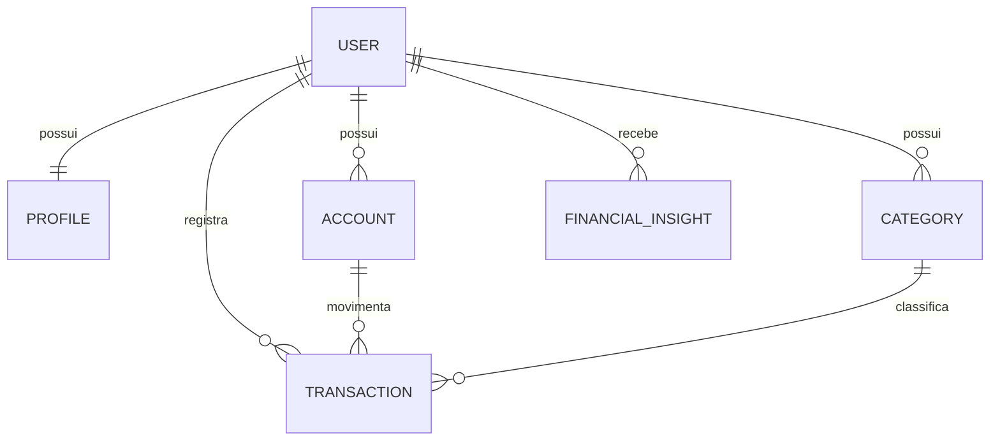

# Modelo de dados

## Diagrama



Todos os models têm `created_at` (`auto_now_add=True`) e `updated_at` (`auto_now=True`).

## User (`users`)

Herda de `AbstractUser`, sem o campo `username`.

| Campo | Tipo | Observação |
|---|---|---|
| `email` | `EmailField` | `unique=True`, usado como login |
| `first_name` | `CharField` | Obrigatório no cadastro |
| `last_name` | `CharField` | Obrigatório no cadastro |
| `password`, `is_active`, `is_staff`, `is_superuser`, `last_login`, `date_joined` | — | Herdados do Django |

- `username = None`, `USERNAME_FIELD = 'email'`, `REQUIRED_FIELDS = []`.
- `objects = UserManager()` (em `users/managers.py`):
  - `create_user(email, password=None, **extra_fields)`: exige e-mail, normaliza com `normalize_email` e usa `set_password`;
  - `create_superuser(email, password=None, **extra_fields)`: força `is_staff=True` e `is_superuser=True`.
- `__str__` retorna o e-mail.

## Profile (`profiles`)

| Campo | Tipo | Observação |
|---|---|---|
| `user` | `OneToOneField` | `CASCADE`, `related_name='profile'` |
| `phone` | `CharField` | Opcional |
| `birth_date` | `DateField` | Opcional |

Criado automaticamente por um signal `post_save` do usuário em `profiles/signals.py`.

## Account (`accounts`)

| Campo | Tipo | Observação |
|---|---|---|
| `user` | `ForeignKey` | `CASCADE`, `related_name='accounts'` |
| `name` | `CharField` | |
| `bank` | `CharField` | Opcional |
| `account_type` | `CharField` (choices) | `checking`, `savings`, `wallet`, `investment` |
| `initial_balance` | `DecimalField` | `max_digits=12`, `decimal_places=2`, `default=0` |

Choices: `checking` → Conta corrente, `savings` → Poupança, `wallet` → Carteira, `investment` → Investimento.

**Saldo atual** = `initial_balance + entradas − saídas`. É calculado via ORM (`Sum` condicional com `filter=Q(...)`) e **nunca** fica salvo em campo. Nas listagens, usa-se `annotate()` para evitar N+1.

`ordering = ['name']`.

## Category (`categories`)

| Campo | Tipo | Observação |
|---|---|---|
| `user` | `ForeignKey` | `CASCADE`, `related_name='categories'` |
| `name` | `CharField` | |
| `category_type` | `CharField` (choices) | `income` (Entrada) ou `expense` (Saída) |

- `UniqueConstraint(fields=['user', 'name', 'category_type'])`.
- `ordering = ['category_type', 'name']`.

## Transaction (`transactions`)

| Campo | Tipo | Observação |
|---|---|---|
| `user` | `ForeignKey` | `CASCADE` |
| `account` | `ForeignKey` | `PROTECT`, `related_name='transactions'` |
| `category` | `ForeignKey` | `PROTECT`, `related_name='transactions'` |
| `transaction_type` | `CharField` (choices) | Reaproveita `INCOME`/`EXPENSE` de `Category` |
| `description` | `CharField` | |
| `amount` | `DecimalField` | `max_digits=12`, `decimal_places=2`, `MinValueValidator(Decimal('0.01'))` |
| `date` | `DateField` | |

`ordering = ['-date', '-created_at']`.

## FinancialInsight (`ai`)

Análise financeira gerada pelo agente de IA (seção 14.7 do PRD). Os registros nunca são editados pela aplicação: cada geração cria um novo registro (histórico).

| Campo | Tipo | Observação |
|---|---|---|
| `user` | `ForeignKey` | `CASCADE`, `related_name='financial_insights'` |
| `status` | `CharField` (choices) | `COMPLETED = 'completed'` ("Concluída") e `INSUFFICIENT_DATA = 'insufficient_data'` ("Dados insuficientes"); falhas não são gravadas |
| `summary` | `TextField` | Resumo da análise ou mensagem padrão de dados insuficientes |
| `insights` | `JSONField(default=list)` | Lista de `{'title': str, 'description': str}` |
| `tips` | `JSONField(default=list)` | Mesma estrutura de `insights` |
| `period_start` / `period_end` | `DateField` | Janela analisada, definida pelo service (não pelo modelo de IA) |
| `model_name` | `CharField(max_length=50, blank=True)` | Modelo usado (ex.: `gpt-5-mini`); vazio em `insufficient_data` |
| `input_tokens` / `output_tokens` | `PositiveIntegerField(null=True, blank=True)` | Soma do `usage_metadata` das respostas do modelo |

`ordering = ['-created_at']`, índice `ai_insight_user_created_idx` em `(user, -created_at)` (consulta do dashboard). No admin é somente leitura.

## Regras de integridade

- `PROTECT` em `Transaction.account` e `Transaction.category` impede excluir contas ou categorias que tenham transações.
- Valores monetários sempre em `DecimalField`, nunca `float`.
- Todo dado pertence a um usuário (`user`), e todas as consultas filtram por ele.

## Exemplo de model

```python
from django.conf import settings
from django.db import models


class Category(models.Model):
    INCOME = 'income'
    EXPENSE = 'expense'
    TYPE_CHOICES = [
        (INCOME, 'Entrada'),
        (EXPENSE, 'Saída'),
    ]

    user = models.ForeignKey(
        settings.AUTH_USER_MODEL,
        on_delete=models.CASCADE,
        related_name='categories',
        verbose_name='usuário',
    )
    name = models.CharField('nome', max_length=60)
    category_type = models.CharField('tipo', max_length=10, choices=TYPE_CHOICES)
    created_at = models.DateTimeField('criado em', auto_now_add=True)
    updated_at = models.DateTimeField('atualizado em', auto_now=True)

    class Meta:
        verbose_name = 'categoria'
        verbose_name_plural = 'categorias'
        ordering = ['name']
        constraints = [
            models.UniqueConstraint(
                fields=['user', 'name', 'category_type'],
                name='unique_category_per_user_and_type',
            ),
        ]

    def __str__(self):
        return self.name
```
