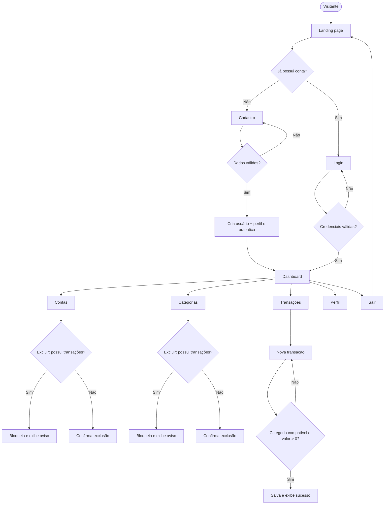

# Regras de negócio

Resumo dos requisitos funcionais (RF) do PRD.

## Site público

- `/` é pública e mostra a landing page (hero, recursos e chamada final "Comece agora, é grátis").
- Visitante vê **Cadastre-se** e **Entrar**; usuário logado vê **Ir para o dashboard**.

## Autenticação

- **Cadastro**: nome, sobrenome, e-mail, senha e confirmação. O e-mail é único.
- Após o cadastro, o usuário é autenticado e vai para o dashboard.
- **Login** com e-mail e senha, redirecionando para o dashboard ou para a URL do `next`.
- **Logout** via POST, redirecionando para a landing page.
- Rotas privadas redirecionam visitantes para `/entrar/?next=<rota>`.
- Usuário logado que acessa login ou cadastro é redirecionado ao dashboard.

## Perfil

- Criado automaticamente no cadastro (signal).
- Mostra nome, sobrenome, e-mail, telefone e data de nascimento.
- Permite editar nome, sobrenome, telefone e data de nascimento. O e-mail é só leitura.

## Contas bancárias

- Campos: nome, banco, tipo e saldo inicial.
- A lista mostra o saldo atual de cada conta: positivo em verde, negativo em rosa.
- Conta com transações **não pode ser excluída**.

## Categorias

- Campos: nome e tipo (Entrada/Saída).
- O nome é único por usuário e por tipo.
- A lista separa as categorias de entrada e as de saída.
- Categoria com transações **não pode ser excluída**.

## Transações

- Campos: tipo, descrição, valor, data, conta e categoria.
- A data vem preenchida com o dia atual (`timezone.localdate()`).
- Os selects mostram só as contas e categorias do usuário; as categorias aparecem agrupadas em "Entradas" e "Saídas".
- A categoria precisa ser do mesmo tipo da transação.
- O valor precisa ser maior que zero.
- A lista vai da mais recente para a mais antiga, com 20 itens por página.
- Filtros via GET: tipo, conta, categoria, data inicial e data final. A paginação mantém os filtros.
- Sem contas ou categorias cadastradas, o formulário mostra um aviso com links para cadastrá-las.

## Dashboard

- Stat cards: **Saldo total**, **Entradas do mês**, **Saídas do mês** e **Resultado do mês** (entradas − saídas).
- O mês considerado é o mês corrente no fuso `America/Sao_Paulo`.
- Lista de contas com saldo atual e link "Gerenciar contas".
- Últimas 5 transações, com link "Ver todas".
- Atalhos: Nova transação, Nova conta e Nova categoria.
- Usuário sem dados vê valores zerados e empty states com os primeiros passos.
- Card **Análise financeira** (logo abaixo dos stat cards) com a análise de IA mais recente do usuário; o dashboard nunca chama a IA.

## Análise financeira com IA

Especificação completa na seção 14 do PRD.

- A app `ai` gera, para cada usuário, uma análise com resumo, de 2 a 5 insights e de 2 a 5 dicas, em português e com valores em reais, usando **somente os dados do próprio usuário** (RF-39, RF-40).
- Período analisado: do 1º dia do mês de dois meses atrás até hoje, no fuso `America/Sao_Paulo` (ex.: em 29/10/2026, de 01/08/2026 a 29/10/2026).
- Com menos de `AI_MIN_TRANSACTIONS` (padrão 5) transações no período, é gravado um registro de **dados insuficientes** sem chamar a IA; se o último registro do usuário já for de dados insuficientes, nada é gravado.
- Toda análise é gravada em `FinancialInsight` (histórico; nada é sobrescrito). Falhas (chave ausente, timeout, rate limit, erro da API, saída inválida) não gravam registro e são registradas no logger `ai` sem dados financeiros, e-mails ou a chave.
- Gatilhos: o command `python manage.py generate_financial_insights [--user <e-mail>]` (usuários ativos, um por vez, com resumo final) e o botão **Gerar nova análise** do dashboard (POST, intervalo mínimo de `AI_MANUAL_COOLDOWN_MINUTES`, padrão 60, por usuário, contando também as tentativas com falha).
- O botão só aparece quando `OPENAI_API_KEY` está configurada.
- O LLM recebe apenas agregados, nomes de categorias, tipos de conta, datas e valores; nunca nome, e-mail, telefone, data de nascimento, descrições de transações ou nomes de contas e bancos. As tools são somente leitura e o `user_id` vem do contexto de execução, nunca do modelo.
- O card exibe o aviso fixo: "Análise gerada por IA com base nos seus lançamentos. Não constitui recomendação de investimento."

## Regras gerais

- Cada usuário vê e altera **somente os próprios dados**. Acessar objeto de outro usuário retorna **404**.
- Toda criação, edição e exclusão mostra uma mensagem de feedback em português.
- Toda exclusão passa por uma página de confirmação.
- Listas vazias mostram um empty state com chamada para cadastro.

## Mensagens padrão

| Situação | Mensagem |
|---|---|
| Cadastro concluído | Conta criada com sucesso. Bem-vindo(a) ao Finanpy! |
| E-mail duplicado | Já existe um usuário com este e-mail. |
| Login inválido | E-mail ou senha inválidos. |
| Perfil salvo | Perfil atualizado com sucesso. |
| Conta criada / atualizada / excluída | Conta criada com sucesso. / Conta atualizada com sucesso. / Conta excluída com sucesso. |
| Conta com transações | Esta conta possui transações e não pode ser excluída. |
| Categoria criada / atualizada / excluída | Categoria criada com sucesso. / Categoria atualizada com sucesso. / Categoria excluída com sucesso. |
| Categoria duplicada | Você já possui uma categoria com este nome e tipo. |
| Categoria com transações | Esta categoria possui transações e não pode ser excluída. |
| Transação criada / atualizada / excluída | Transação registrada com sucesso. / Transação atualizada com sucesso. / Transação excluída com sucesso. |
| Categoria de tipo diferente | A categoria deve ser do mesmo tipo da transação. |
| Valor inválido | O valor deve ser maior que zero. |
| Análise gerada (success) | Análise gerada com sucesso. |
| Dados insuficientes para a análise (warning) | Ainda não há dados suficientes para gerar uma análise. Registre ao menos 5 transações nos últimos 3 meses. (o número vem de `AI_MIN_TRANSACTIONS`) |
| Pedido de análise dentro do intervalo de espera (warning) | Você gerou uma análise recentemente. Aguarde alguns minutos para gerar outra. |
| Falha da IA ou chave ausente (error) | Não foi possível gerar a análise agora. Tente novamente mais tarde. |
| Resumo padrão de dados insuficientes (gravado na análise) | Ainda não há lançamentos suficientes no período para uma análise. Continue registrando suas entradas e saídas. |
| Aviso fixo no card de análise | Análise gerada por IA com base nos seus lançamentos. Não constitui recomendação de investimento. |

## Fluxos de UX

O fluxograma completo está na seção 6.9 do [PRD.md](../PRD.md).
